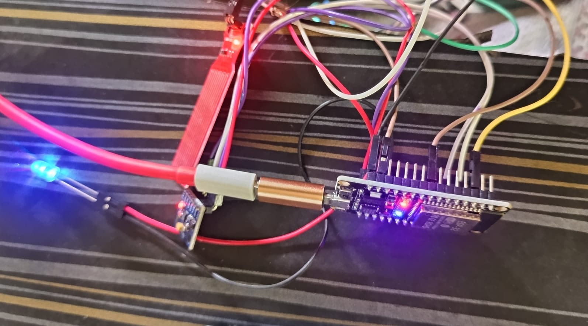
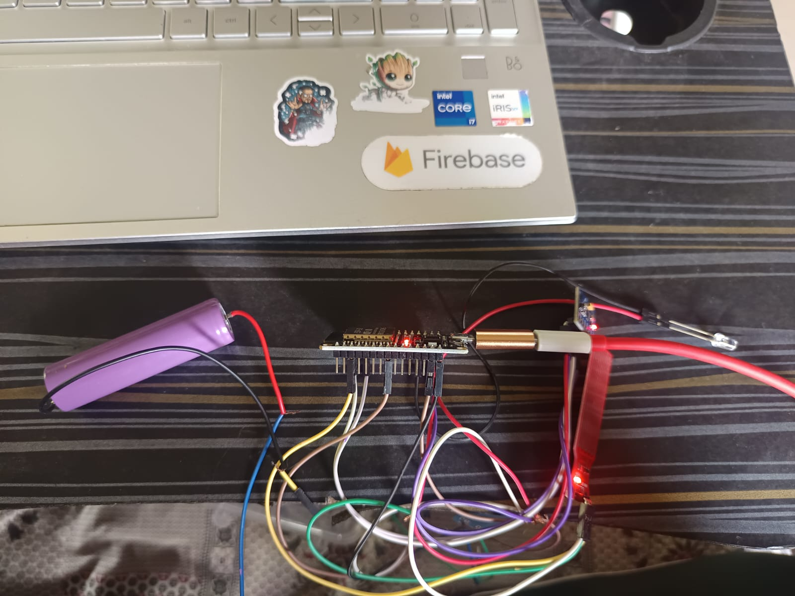

# SmartTrack Guardian

An ESP32 BLE-based anti-loss wallet tracker prototype with an Android-app integration contract.

## Repository contents

```text
SmartTrack-Guardian/
├── ESP32/
│   └── SmartTrack_ESP32.ino
├── Android/
│   └── README.md
├── docs/
│   └── images/
│       ├── hardware-prototype-esp32-usb.jpeg
│       └── hardware-prototype-battery.jpeg
├── README.md
└── .gitignore
```

**Scope note:** This package contains the ESP32 firmware and Android integration documentation. The original Android Studio Kotlin source project was not available among the files used to create this package, so `Android/` is not currently a buildable Android app.

## Hardware prototype photos

The following photos show the current physical prototype and its wiring arrangement. They are included as build-progress references; wire colours and component appearance alone should not be treated as a verified pinout.

### ESP32 connected over USB



The ESP32 DevKit V1 is connected to the computer through USB. Jumper wires connect the board to the prototype components, and indicator LEDs are illuminated during the test.

### Prototype with battery and connected modules



This photo shows the ESP32 board, a cylindrical rechargeable cell, jumper-wire connections, and a small auxiliary circuit board. The exact battery protection/charging arrangement and the small board's function are not confirmed from the photo, so check their labels and wiring before powering the circuit.

## ESP32 features

- Advertises as `SmartTrack_Wallet` over BLE.
- Exposes the existing SmartTrack GATT service and TX/RX characteristics.
- Accepts `RING_ON` and `RING_OFF`.
- Controls an active buzzer on GPIO 25 and LED on GPIO 2.
- Reads HW-038 analog output on GPIO 34.
- Sends JSON status notifications every 5 seconds.
- Prints sensor readings and connection state to Serial Monitor.

## Hardware and wiring

| Component | ESP32 DevKit V1 |
|---|---|
| HW-038 VCC | 3.3V |
| HW-038 GND | GND |
| HW-038 AO/A0 | GPIO 34 |
| Active buzzer + | GPIO 25 |
| Active buzzer - | GND |
| LED anode (+), through resistor | GPIO 2 |
| LED cathode (-) | GND |

Use the sensor's analog output (AO/A0). Keep the ESP32 and other electronics dry; wet only the sensing plate. Confirm that your buzzer can safely be driven from a GPIO; use a transistor driver if its current requirement is too high.

## Upload firmware

1. Install Arduino IDE and the Espressif ESP32 board package.
2. Select **ESP32 Dev Module** and the correct serial port.
3. Open `ESP32/SmartTrack_ESP32.ino`.
4. Upload to the ESP32.
5. Open Serial Monitor at **115200 baud**.

The BLE APIs are provided by the ESP32 Arduino core; a separate BLE library is normally unnecessary.

## BLE interface

| Item | Value |
|---|---|
| Device name | `SmartTrack_Wallet` |
| Service UUID | `4A5B0001-0000-1000-8000-00805F9B34FB` |
| TX (ESP32 to phone; READ + NOTIFY) | `4A5B0002-0000-1000-8000-00805F9B34FB` |
| RX (phone to ESP32; WRITE + WRITE_NR) | `4A5B0003-0000-1000-8000-00805F9B34FB` |

Write the exact UTF-8 command `RING_ON` or `RING_OFF` to RX. The firmware does not implement `PING`.

## Example status payload

```json
{
  "device": "SmartTrack_Wallet",
  "status": "CONNECTED",
  "ringing": false,
  "water": false,
  "waterValue": 240,
  "battery": null
}
```

`waterValue` is the ESP32 12-bit ADC reading. Battery is `null` because battery-voltage measurement is not implemented in this firmware.

## HW-038 threshold calibration

The initial setting is `WATER_THRESHOLD 500`. This is a starting value only; module output varies.

1. Keep the plate dry and note the `Water ADC` value.
2. Wet only the sensing plate and note the new value.
3. Set the threshold between the dry and wet readings.
4. If wet readings are LOWER than dry readings, change the comparison `value > WATER_THRESHOLD` to `value < WATER_THRESHOLD` in both `sendStatus()` and `loop()`.

If the ADC stays at zero, check VCC, GND and AO wiring, and test GPIO 34 independently. Do not short 3.3V to GND.

## Android integration

The Android app should connect using BLE GATT, discover the service and characteristics, enable TX notifications (including the CCCD), write commands to RX, and parse the status JSON.

For anti-loss detection, RSSI is measured by Android using `BluetoothGatt.readRemoteRssi()` on the existing GATT connection. Suggested starting values (calibrate in the actual environment):

- Warning: -75 dBm
- Lost: -90 dBm continuously for 5 seconds
- Recovery: stronger than -80 dBm for 3–5 seconds
- Sampling: approximately once per second

Do not trigger from one weak sample. Use a state machine, avoid overlapping RSSI reads, send `RING_ON` once per lost event, and send `RING_OFF` only after stable recovery. RSSI is not an exact distance measurement. See `Android/README.md`.

## Not implemented in this firmware

- Android RSSI monitoring and automatic loss detection (Android responsibility)
- Battery-voltage measurement
- MPU6050 motion sensing
- GPS/location history
- Cloud/Firebase connectivity

## Safety

Do not immerse the electronics. Use an appropriate LED resistor and a suitable buzzer driver. Do not connect a LiPo cell directly to an ESP32 GPIO or 3.3V pin; use a suitable charging and regulated power design.

## License

Add a license file (for example, MIT) if you want to define reuse and contribution terms.
